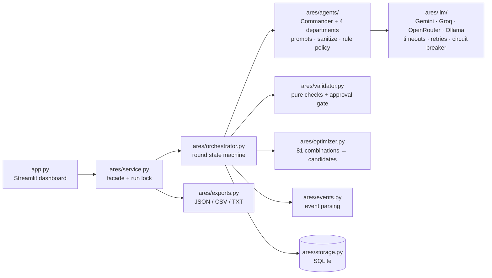
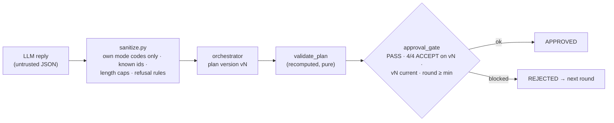

# ARES Accord — LLM agents inside a deterministic, verifiable negotiation protocol

[](https://github.com/dayan-ai/ares-accord/actions/workflows/python-package-conda.yml)


A multi-agent crisis-negotiation simulator for a Mars colony. Five LLM agents (Gemini, Groq, OpenRouter or a local
Ollama model) negotiate how to share scarce resources. **Deterministic code, not a model, decides what gets
approved.** Every plan is re-validated by pure functions, and an approval gate the agents cannot bypass requires a
validator PASS and four department votes on the current plan version.

Built for the Looplab × LifixLabs **ARES Accord** 24-hour AI/ML hackathon (October 2026), then hardened as a
portfolio project. Changes since the submission are listed in [`CHANGELOG.md`](CHANGELOG.md).

---

## Contents

[Problem](#the-problem) · [What it does](#what-it-does) · [How it works](#how-it-works) ·
[Quick start](#quick-start) · [Configuration](#configuration) · [Reproducible demo](#reproducible-demo) ·
[Using the dashboard](#using-the-dashboard) · [Testing and quality](#testing-and-quality) ·
[Security](#security-considerations) · [Limitations](#limitations) · [Roadmap](#future-improvements) ·
[Licence](#licence-and-third-party-material)

## The problem

Letting LLM agents negotiate over shared resources is easy to demo and hard to trust. Models invent numbers,
claim agreements that never happened, ignore constraints, or simply say "approved". In this scenario the stakes
are explicit:
- A damaged Mars colony (42 people, 6 injured) has one pool of Power, Water, Oxygen, Robot time and Bandwidth that
  cannot satisfy all four departments.
- Someone has to accept a severe **Sacrifice** mode and be compensated.
- When a new crisis arrives mid-plan, the council must replan, or prove that no plan exists, within three minutes.

The engineering question this project answers: **how do you get useful negotiation behaviour from LLM agents
while guaranteeing that nothing invalid is ever approved?**

## What it does

- **Five agents with private state.** A Commander and four departments (Life Support, Medical, Food Production,
  Engineering), each with its own profile, goals, constraints and persisted memory. Every agent turn is a
  separate LLM call with its own prompt.
- **Fixed, published options.** Each department picks exactly one of three mode packages (Standard / Restricted /
  Sacrifice; 12 packages in total, with fixed resource use and risk). Agents cannot invent or edit numbers.
- **Negotiation protocol.** Proposals, objections, counter-offers, Sacrifice refusals, return commitments,
  numbered plan versions, validation and votes, over a minimum of 3 rounds (baseline) or 2 (after an event).
- **Deterministic validator and approval gate.** Resources must fit the pool. Risk must be within the policy
  limit (24 at baseline). At most one Sacrifice is allowed at baseline, and every sacrificing department needs
  two accepted return commitments from different agents. Approval requires a validator PASS plus 4/4 ACCEPT
  votes on the current version.
- **Crisis events.** A judge injects events as the official JSON format, flat keys or free text ("Available Power
  decreases by 4"). The parser shows how it interpreted the input before applying it. The approved plan becomes
  STALE, commitments are reviewed, and **Crisis Override** (risk 28, two Sacrifices) is available only after an
  event. The result is a new approved plan or a justified **INFEASIBLE** verdict naming the blocking constraints
  and the change that would fix them.
- **Fact-checking of votes.** If a department rejects a plan for a reason that contradicts the verified plan
  facts, the validator shows it the facts and lets it reconsider once. The original vote stays on record.
- **Resilient LLM layer.** Per-call time budgets, bounded retries with `Retry-After`, a circuit breaker, model
  fallback on 404, tolerant JSON extraction (never `eval`) and one repair retry. If a provider still fails, *that
  agent's turn* falls back to a deterministic policy and is labelled **RULE-BASED FALLBACK**. It is never shown
  as model output.
- **Human-in-the-loop (optional).** High-risk plans (risk > 20) can require a judge co-sign or veto.
- **Streamlit dashboard and exports.** Mission control, mode board, live transcript, validation and votes,
  scenario history, plus JSON / CSV / TXT exports.
- **Fully offline mode.** The `rule-based` provider runs the whole protocol without any LLM or API key. This is
  what the tests and the reproducible demo use.

## How it works

### Architecture



| Module | Responsibility |
|---|---|
| `ares/models.py` | The contract: 12 immutable mode packages, policies, return templates, dataclasses |
| `ares/orchestrator.py` | Rounds, plan versions, vote clearing, deadlines, scenario endings |
| `ares/agents/` | Prompt building (`prompts.py`), LLM-output sanitising (`sanitize.py`), deterministic fallback policy (`rule_policy.py`) |
| `ares/validator.py` | `validate_plan` (seven checks, never short-circuits) and `approval_gate` |
| `ares/optimizer.py` | Brute-forces all 3⁴ = 81 combinations to list feasible candidates and diagnose infeasibility. It never approves anything. |
| `ares/events.py` | Turns judge input into a `CrisisEvent`, recording every interpretation decision |
| `ares/factcheck.py` | Compares a REJECT reason with verified plan facts |
| `ares/log.py` | `key=value` logging with secret redaction |

More detail, including component, sequence and state diagrams: [`docs/ARCHITECTURE.md`](docs/ARCHITECTURE.md).
Interface contract: [`docs/CONTRACT.md`](docs/CONTRACT.md). Assumptions and spec conflicts:
[`docs/DECISIONS_AND_RISKS.md`](docs/DECISIONS_AND_RISKS.md).

### Agent workflow

1. **Briefing.** The Commander states the pool, the policy limits and the round limit.
2. **Round 1 (proposals).** Every department asks for its Standard mode and states what Restricted and Sacrifice
   would cost it. The resulting plan v1 fails validation, because the pool is too small by design.
3. **Rounds 2+ (negotiation).**
   - The Commander picks a target from the optimizer's feasible candidates and requests modes.
   - Departments object, counter-propose, refuse or accept a Sacrifice, and offer or accept return commitments.
   - A department always refuses a Sacrifice in the round it is first asked.
   - Any change creates a new plan version and clears earlier votes. The validator runs on every version.
4. **Vote.** Once a version passes and the minimum round is reached, all four departments vote. The approval gate
   decides.
5. **Endings.** APPROVED, DEADLOCK (max rounds), TIMEOUT (deadline), INFEASIBLE (no candidate exists) or ERROR
   (an internal failure, recorded safely and never approved).

### The deterministic approval gate

Everything an LLM returns is treated as untrusted data:



- `APPROVED` is written in exactly two places, and both come after the gate. One is `Orchestrator._vote`. The
  other is the optional judge co-sign, which only acts on plans that already passed the gate.
- The Commander cannot approve. A department cannot vote for another. Votes on stale versions are rejected, and
  any plan change clears votes.
- An agent can ask for Crisis Override, but the orchestrator grants it only in EVENT scenarios. The sanitizer
  recomputes the flag from deterministic data anyway.
- **Tested exhaustively** (`tests/test_hardening.py`): for all 81 mode combinations, under both the baseline and
  override policies, the gate approves exactly the plans the validator passes. Every approved plan also
  satisfies an independent re-statement of the hard limits. A mutation matrix confirms that breaking any single
  precondition blocks approval.

## Quick start

Requires **Python 3.12 or 3.13**. Both pass a clean install, the tests and a Streamlit health check locally;
GitHub Actions CI runs Python 3.12 only. No API key is needed for the rule-based mode.

```bash
git clone https://github.com/dayan-ai/ares-accord.git
cd ares-accord
python -m venv .venv
# Windows: .venv\Scripts\activate      macOS/Linux: source .venv/bin/activate
python -m pip install -r requirements.txt
python -m streamlit run app.py
```

Open http://localhost:8501, keep the provider on **rule-based** (or configure one below), and press
**Start baseline crisis**. One-click scripts: `scripts/run.sh` / `scripts/run.ps1` create the venv, install,
copy `.env` and launch.

Conda users: `conda env create -f environment.yml && conda activate ares-accord`, then
`python -m pip install -r requirements-dev.txt`.

## Configuration

Copy `.env.example` to `.env` and fill in **only** the provider you use. `.env` is git-ignored and must never be
committed. Numeric settings that are non-numeric or not finite (`nan`, `inf`) fall back to their default, with a
logged warning (except `ARES_LLM_MAX_RETRIES`). Negative deadlines are ignored the same way; LLM timing and retry
values are clamped to the ranges below.

| Provider (`ARES_PROVIDER`) | Variables | Notes |
|---|---|---|
| `rule-based` (default) | — | No LLM. Deterministic policy; every turn labelled as fallback. |
| `gemini` | `GEMINI_API_KEY` (or `GOOGLE_API_KEY`), `GEMINI_MODEL` | Google AI Studio free tier |
| `groq` | `GROQ_API_KEY`, `GROQ_MODEL` | Free tier, tokens-per-minute limits |
| `openrouter` | `OPENROUTER_API_KEY`, `OPENROUTER_MODEL`, `OPENROUTER_ALLOW_PAID` | `:free` models only unless `OPENROUTER_ALLOW_PAID=1` |
| `ollama` | `OLLAMA_BASE_URL` (default `http://localhost:11434`), `OLLAMA_MODEL` | Local, no key |

| Variable | Default | Meaning |
|---|---|---|
| `ARES_LLM_TIMEOUT_S` | 25 | Budget per LLM call, including retries (minimum 2) |
| `ARES_LLM_MAX_RETRIES` | 2 | Bounded retries (0–5) |
| `ARES_LLM_MIN_INTERVAL_S` | 0 | Pacing between calls; 0 = each provider's built-in pacing |
| `ARES_<PROVIDER>_MIN_INTERVAL_S` | — | Per-provider pacing override, e.g. `ARES_GROQ_MIN_INTERVAL_S` |
| `ARES_SCENARIO_DEADLINE_S` | 170 | Wall-clock budget after a crisis event, giving TIMEOUT (the challenge allows 3 minutes) |
| `ARES_BASELINE_DEADLINE_S` | 600 | Wall-clock budget for the baseline run |
| `ARES_DB_PATH` | `data/ares.db` | SQLite history used by the dashboard |
| `ARES_LOG_LEVEL` | INFO | DEBUG / INFO / WARNING / ERROR. In the dashboard, a value set only in `.env` applies from the first rerun; set it in the environment to apply at startup. |

Default model ids and fallbacks are in `ares/llm/providers.py`. Provider quotas and model availability change
over time.

## Reproducible demo

A headless end-to-end run (baseline crisis, then a "Power −4" event) with the deterministic provider:

```bash
python scripts/smoke_run.py --provider rule-based --db data/smoke.db --export exports/demo
```

- The output and the exported bundle are deterministic apart from timestamps and the generated event id.
- A committed copy of that bundle, with a guide to what each file shows, is in [`docs/demo/`](docs/demo/).
- The database passed with `--db` is **deleted and recreated** on every run. The script refuses to use the
  dashboard database (`ARES_DB_PATH`).
- The official sample event (a 30% power cut) can be replayed with
  `--event tests/fixtures/event_injection_format.json`. It is correctly proven **INFEASIBLE** at once, with the
  blocking constraints and the change needed.
- With a provider key in `.env`, pass `--provider gemini|groq|openrouter|ollama`. Model turns are tagged
  `[llm/<provider>]` and fallbacks `[rule-based]`.

The rule-based demo shows the protocol, validator and exports working. **It is not evidence of LLM negotiation
quality**; see [Limitations](#limitations).

## Using the dashboard

1. **Judge Controls** (sidebar): check the pool (default 79/52/59/26/17), choose a provider (✅ = configured),
   set the max rounds, and press **Start baseline crisis**.
2. **Council Transcript**: briefing, proposals, conflicts, objections, refusals, counter-offers, commitments,
   plan versions, validation and votes, each labelled LLM or RULE-BASED FALLBACK.
3. **Validation & Votes**: PASS/FAIL per check with reasons. **Mode Board**: each department's package,
   consequence, risk and commitments. **Mission Control**: pool, used, reserve, round, plan version, status.
4. **Inject event**: paste official-format JSON, type free text, or use the form. Preview shows the interpreted
   change before it is applied.
5. **Export**: prepare and download the bundle. `final_allocation.json` (one record per agent in the starter-kit
   shape), `final_plan.json`, `council_transcript.json/.csv/.txt`, `crisis_handling_log.txt`, `plans.csv`,
   `full_history_all_sessions.csv`.
6. **↺ Reset session (keep history)** clears the current session only. **🗑 Wipe all history** clears the SQLite
   store once you tick its confirmation box.

## Testing and quality

```bash
python -m pip install -r requirements-dev.txt
python -m ruff check .
python -m pytest -q --cov=ares
python -m pip install mypy && python -m mypy ares --ignore-missing-imports   # optional; not a gate
```

Re-measured on merged `main` (`c3fa02a`) on 2026-11-09. Every run is offline and needs no API key; LLM behaviour
is tested with fake providers.

| Check | Result |
|---|---|
| pytest | **312 passed**, 0 failed, 0 warnings |
| Coverage (`--cov=ares`) | **88%** (validator 97%, optimizer 98%, orchestrator 93%; UI modules 57–88%) |
| ruff (`ruff.toml`: E, F, W, B) | all checks passed |
| mypy 2.4.1 (`mypy ares --ignore-missing-imports`) | **96 errors** in 14 files. A known gap: mostly `Optional` narrowing; not a gate, and not in `requirements-dev.txt`. |
| GitHub Actions on `main` (Ubuntu, conda, Python 3.12.16) | ruff clean, 312 passed, 88% coverage |
| Clean clone on Windows, Python 3.12.14 and 3.13.6 | pinned install, ruff, 312 passed, headless demo and Streamlit health check pass |

What the suites cover:

| Suite | Covers |
|---|---|
| `test_validator.py`, `test_optimizer.py` | Every rule and the approval gate |
| `test_hardening.py` | Exhaustive gate property, prompt-injection delimiting, event-input bounds, config validation, storage allowlist |
| `test_events.py` | Event parsing in all three input styles |
| `test_llm.py` | HTTP 429/5xx, timeouts, malformed JSON, 404 model fallback, circuit breaker |
| `test_agents.py`, `test_orchestrator*.py`, `test_live_fix.py` | Hostile agents, bypass attempts, deadlocks, deadlines, fallbacks |
| `test_acceptance.py` | End-to-end scenarios and export shapes |
| `test_ui_smoke.py` | Renders the real Streamlit app and drives a run to APPROVED |
| `test_observability.py` | Structured logs and secret redaction |

CI: `.github/workflows/python-package-conda.yml` runs on every push and pull request: a conda environment from
`environment.yml` (Python 3.12), the pinned `requirements-dev.txt`, ruff, and pytest with coverage. Dependencies
are pinned in `requirements.txt` (runtime) and `requirements-dev.txt` (tooling); transitive dependencies are not
locked.

## Security considerations

- **Secrets.** Keys come only from environment variables or `.env` (git-ignored). They are sent only in HTTP
  headers, hidden from object `repr`, and never written to exports. Provider error messages pass through
  `redact_secrets`, which masks configured key values and key-shaped tokens. So does every log record emitted
  through the `ares` handler, including tracebacks.
- **Model output is data.** It is parsed as JSON, sanitised, and never passed to `eval` or `exec`. Approval is
  decided only by the deterministic gate.
- **Prompt injection.**
  - Untrusted free text (judge events, other agents' messages, memory, offer text, vote reasons) is wrapped in
    `[[ ]]`, and every system prompt says that delimited text is data, not instructions.
  - That is defence in depth. The guarantee comes from the sanitizer and the gate: a successfully injected agent
    can only argue or vote, and cannot make an invalid plan pass.
- **Input bounds.**
  - Event input larger than 5,000 characters, or nested too deeply, is rejected with a clear error before any
    parsing. Free-text parsing cost grows faster than linearly; a 66 kB input took 73 s before this limit.
  - Event values that are non-finite or larger than 1,000,000 in magnitude are ignored with a note.
- **Storage.** All SQL values are parameterised, and dynamic column names are checked against the schema.
- **UI.** Every dynamic value rendered as HTML is escaped.

Details and threat notes: [`docs/SECURITY.md`](docs/SECURITY.md) and
[`docs/ARCHITECTURE.md` §7](docs/ARCHITECTURE.md#7-security).

## Limitations

- **The protocol is scripted.**
  - Rounds follow a fixed order, and the Commander chooses from candidates the optimizer brute-forced.
  - The sanitizer overrides some LLM decisions; for example, a department must refuse a Sacrifice the first time
    it is asked.
  - Agents have no tools or function calling.

  "LLM agents inside a deterministic protocol" is the accurate description; "autonomous agents" is not.
- **No measured LLM quality.** There is no evaluation harness for convergence rate, rounds to approval or
  fallback rate across providers. Earlier live Gemini runs were observed during the hackathon but are not
  reproducible from this repository.
- **Free-tier providers** can rate-limit mid-run, which forces labelled fallbacks. Slow models can hit the
  170-second post-event deadline.
- **Single-user, local app.**
  - Runs are synchronous in the Streamlit process under one global lock.
  - State is in SQLite.
  - There is no hosted demo and no authentication.
- **Simulation simplifications.** Event durations are recorded, not simulated, and percentage cuts are rounded
  conservatively.
- **Typing and structure.** 96 mypy errors remain, and a few functions are long
  (`sanitize.department_turn`, `rule_policy.department_turn`).
- **CI covers one Python version.** GitHub Actions runs Python 3.12 only; Python 3.13 is verified by local
  clean-clone runs.
- **Test fixtures.** `tests/fixtures/output_schema.json` is reconstructed from documentation, and
  `tests/fixtures/event_injection_format.json` is the organisers' official sample event. See
  `tests/fixtures/README.md`.

## Future improvements

- An **evaluation harness** for LLM negotiation: approval rate, rounds, refusal behaviour and fallback rate, per
  provider and model, over a fixed scenario set.
- Give agents **tools** (query the validator, compare candidates) instead of free-form proposals, so agency
  grows without weakening the gate.
- Run negotiations in a background worker with progress streaming, instead of blocking the UI.
- Resolve the mypy backlog and make type checking a CI gate. Split the long policy functions.
- A hosted, rule-based demo deployment.

## Project history and declarations

- Built in 24 hours for the ARES Accord hackathon (Participant Guide v2.1, Looplab × LifixLabs; the
  [official starter repository](https://github.com/lifix-prog/Loopverse-AI_ML_Virtual_Module)). Requirements:
  [`PRD.md`](PRD.md).
- `docs/TEST_REPORT.md` and `docs/REQUIREMENTS_TRACEABILITY.md` are the hackathon-time snapshots (258 tests at
  submission). Current status is in this README and [`CHANGELOG.md`](CHANGELOG.md).
- **AI assistance:** Claude Code (Anthropic) was used for code, tests and documentation, both during the
  hackathon and in the post-hackathon hardening.
- Third-party software: [Streamlit](https://streamlit.io) (Apache-2.0), [pandas](https://pandas.pydata.org)
  (BSD-3), [requests](https://requests.readthedocs.io) (Apache-2.0),
  [python-dotenv](https://github.com/theskumar/python-dotenv) (BSD-3), [pytest](https://pytest.org) (MIT),
  [pytest-cov](https://github.com/pytest-dev/pytest-cov) (MIT), [ruff](https://docs.astral.sh/ruff/) (MIT); SQLite
  via the Python standard library. None of them is bundled in this repository. LLM APIs are optional and use your
  own keys.

## Licence and third-party material

- **No licence has been chosen yet.** Until a `LICENSE` file is added, the default is all rights reserved.
- **Organiser material.** The organisers' starter kit (challenge PDF, rules and schema files) is not
  redistributed. The repository does contain material taken from it:
  - the scenario, and the 12 mode packages with their figures and consequence texts (`ares/models.py`,
    `ares/agents/profiles.py`);
  - the official sample event, verbatim, in `tests/fixtures/event_injection_format.json` and `ares/ui/controls.py`.

  The starter repository publishes no licence, so this material remains the organisers'. It is not covered by any
  licence later applied to the original code.
