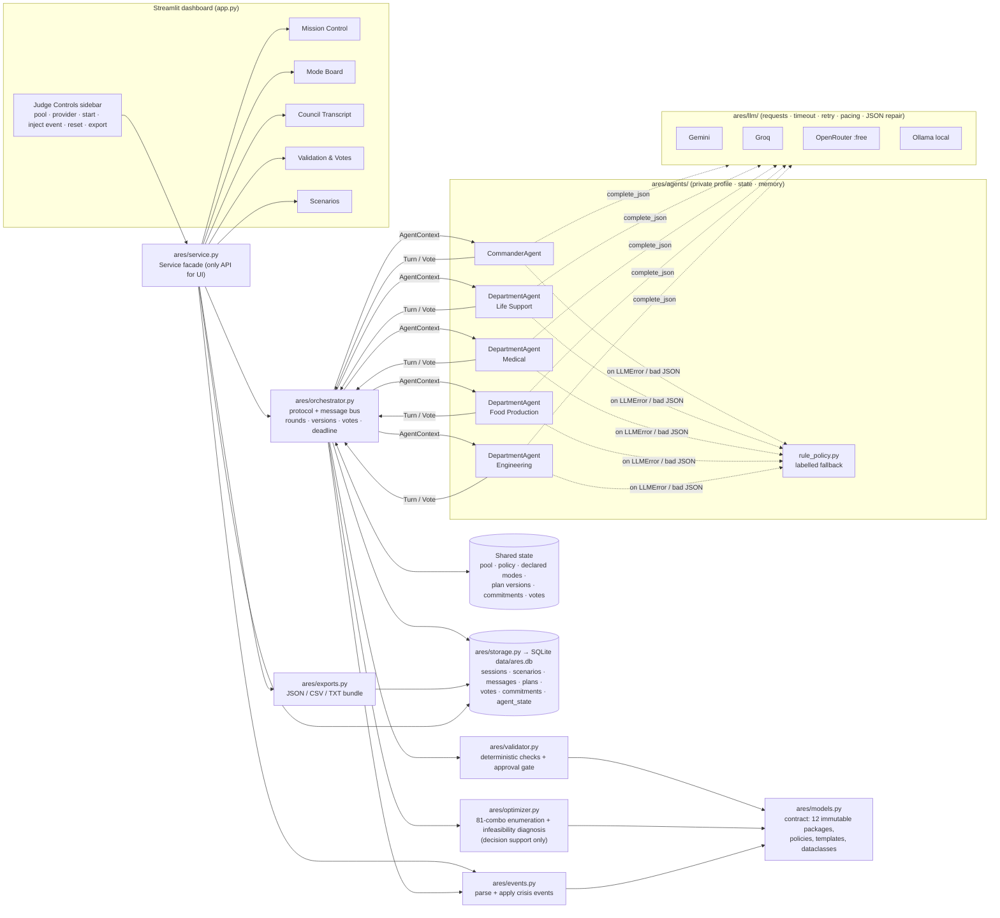
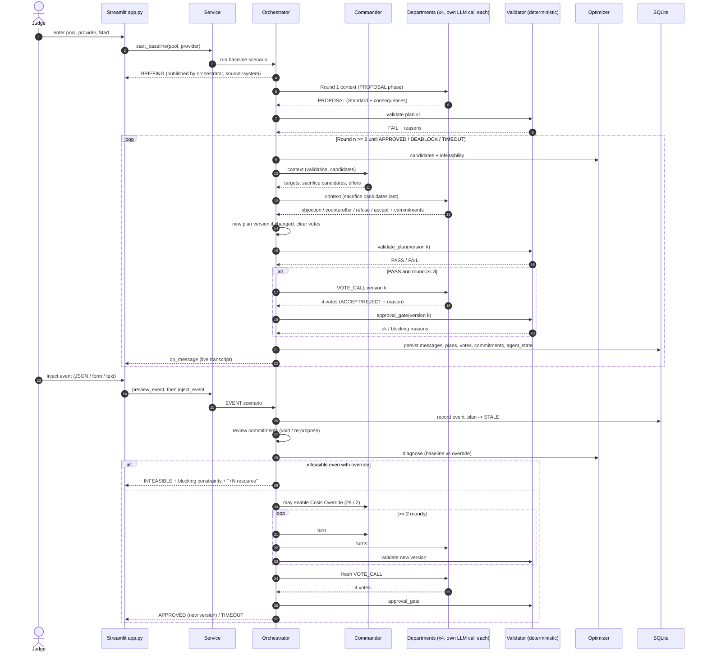

# ARES Accord — Architecture

Status: **design matches `docs/CONTRACT.md` v1; implementation in progress** — re-verify this page against the code
before submission (checklist item "architecture diagram matches implementation", PDF p10).

## 1. Overview

Local Python 3.13 app. A Streamlit dashboard calls a single facade (`ares/service.py`). The orchestrator runs the
negotiation protocol as a system-mediated message bus between five agents, each with private profile/state/memory and
its own LLM call per turn. Every plan version is checked by a **deterministic validator outside the LLM**; approval is
decided by a deterministic **approval gate** (PASS + 4 ACCEPT on the current version + min rounds). An optimizer gives
decision support (candidates, infeasibility diagnosis) but never approves. Everything is persisted to SQLite.

## 2. Component diagram

## 3. Modules

| Module | Responsibility | Notes |
|---|---|---|
| `ares/models.py` | Constants (resources, agents, 12 `MODE_PACKAGES`, policies, `RETURN_TEMPLATES`) and dataclasses (`Commitment`, `ValidationResult`, `Vote`, `CrisisEvent`, `DepartmentTurn`, `CommanderTurn`, `AgentContext`). | Immutable (`MappingProxyType`, frozen dataclasses). |
| `ares/validator.py` | `plan_totals`, `validate_plan` (Mode packages, Resources, Risk, Sacrifice limit, Return agreement, Commitment backing, Policy), `check_votes`, `approval_gate`. | Pure, deterministic. The Commander cannot bypass it. |
| `ares/optimizer.py` | `enumerate_candidates` (all 81 combos filtered + sorted, template-return check), `diagnose_infeasibility` (blocking constraints, nearest plan, "+N Resource" / Crisis Override suggestions). | Decision support shown to agents and judges; never approves. |
| `ares/events.py` | `parse_event` (official starter JSON, absolute, percent, `<res>_set`, forbidden modes, free text, synonyms), `apply_event` (ceil for percent, clamp >= 0, interpretation notes). | Pure. |
| `ares/llm/` | `Provider.complete_json`, `available_providers`, `get_provider`; adapters Gemini, Groq, OpenRouter, Ollama via `requests`; env keys; timeout, bounded retry, min interval pacing, JSON repair; raises `LLMError`. | Default model ids: see `ares/llm/providers.py`. |
| `ares/agents/` | `CommanderAgent`, `DepartmentAgent` ×4, `build_agents`. Private `profile` (mission, concern, p3), `state`, `memory`; prompts; output sanitisation (own mode codes only); per-turn rule-based fallback (`rule_policy.py`) labelled `source=rule-based` + `fallback_reason`. | Agents never edit packages, approve plans, or write other agents' messages. |
| `ares/orchestrator.py` | Protocol (below); plan versioning (global per session), vote clearing, commitments lifecycle, event recovery, deadline/max-round handling. | Calls validator/optimizer every round. |
| `ares/storage.py` | Only module touching SQLite (`ARES_DB_PATH`, default `data/ares.db`). | Persistent across scenarios and restarts. |
| `ares/service.py` | UI facade: `start_baseline`, `inject_event`, `preview_event`, `reset_session`, `wipe_all`, `state`, `transcript`, `export_bundle`, `providers`. | `on_message` callback for live progress. |
| `ares/exports.py` | `final_allocation.json` (starter-schema records), `final_plan.json`, `council_transcript.json/.csv/.txt`, `crisis_handling_log.txt`. | See D3, D4, D7. |
| `app.py` | Streamlit views: Mission Control, Mode Board, Council Transcript, Validation & Votes, Scenarios; Judge Controls sidebar. | Calls only `ares/service.py`. |

## 4. Shared state and storage

Shared state (owned by orchestrator, persisted): current pool and base pool, policy (baseline 24/1 or override 28/2),
each department's declared mode, plan versions (modes, commitment ids, totals, reserve, risk, status, validation, votes),
commitments (owner, beneficiary, kind, resource, amount, source, claim, promise, expiry, status), scenario status.
Agents receive a read-only `AgentContext` snapshot per turn; their private memory lives in `agent_state`.

| Table | Key contents |
|---|---|
| `sessions` | id, created_at |
| `scenarios` | id, session_id, kind (BASELINE/EVENT), name, pool, base_pool, policy, event, status, result_reason, round, max_rounds, provider, timestamps |
| `messages` | id, session_id, scenario_id, round, plan_version, sender, recipient, msg_type, content, payload, source (llm/rule-based/system/validator), provider, model, fallback_reason, created_at |
| `plans` | id, scenario_id, version, modes, commitment_ids, totals, reserve, risk, policy, status (DRAFT/FAILED/VOTING/REJECTED/APPROVED/SUPERSEDED/STALE), validation, round |
| `votes` | plan id/version, agent, decision (ACCEPT/REJECT), reason, source, fallback_reason |
| `commitments` | Commitment fields + status (PROPOSED/ACCEPTED/REJECTED/VOIDED) |
| `agent_state` | per agent: profile, state, memory (JSON) |

## 5. Protocol

**Baseline:** BRIEFING (pool, policy, round limit, version) → Round 1: four PROPOSALs (Standard requested, consequence of
Restricted/Sacrifice stated) → plan v1 drafted + validated (FAIL with reasons on baseline) → Rounds ≥ 2: Commander turn
(CONFLICT/REQUEST: target combo, sacrifice candidates, return offers) → departments speak (sacrifice candidates last:
OBJECTION / COUNTEROFFER / REFUSE_SACRIFICE / ACCEPT_SACRIFICE / commitments offered/accepted) → if any mode or
commitment changed: new plan version, VOTES_CLEARED → validate → if PASS and round ≥ `min_rounds` (3): VOTE_CALL → four
votes → approval gate → APPROVAL or APPROVAL_BLOCKED → next round. Max rounds → DEADLOCK. Deadline → TIMEOUT. Optimizer
reports no candidate (even with allowed override) → INFEASIBLE with blocking constraints + suggested change.

**Event:** EVENT recorded → pool updated → approved plan marked STALE (PLAN_STALE) → commitments reviewed (invalid ones
COMMITMENT_VOIDED; valid ones re-proposed as PROPOSED for re-acceptance) → Commander may enable Crisis Override (EVENT
scenarios only) → ≥ 2 visible rounds (unless proven infeasible immediately) → new version(s) → fresh four votes →
APPROVAL / INFEASIBLE / TIMEOUT.

**Council rules applied to every agent turn** (`ares/agents/sanitize.py`, both LLM and rule-based): a department
may only select its own published codes; Sacrifice cannot be accepted in the round it is first requested and needs
>= 2 return offers from different agents; only the beneficiary can accept a commitment; only template owners can
offer a template. When a rule changes what a model asked for, the change is written into the visible message
("[Council rule overrode ...]") or the reason ("[sanitised: ...]").

**Time budget:** each scenario has a hard deadline (170 s after an event, `ARES_SCENARIO_DEADLINE_S`). Agents receive
`time_budget_s` = time left minus a 20 s grace; LLM calls are capped to it and, below 4 s, the turn uses the labelled
rule-based policy so the council can still finish (APPROVED / INFEASIBLE / DEADLOCK) instead of timing out.

**Human-in-the-loop (bonus, optional):** with the Judge Controls toggle on, a plan that passed the approval gate but
has risk > 20 is stored as `AWAITING_COSIGN`; the judge's Co-sign makes it APPROVED, Veto makes the scenario VETOED.
This is a human approval step, not an agent message.

## 6. LLM providers and fallback

| Provider | Env vars | Notes |
|---|---|---|
| `rule-based` (default) | — | No LLM; every turn labelled rule-based. For offline tests/smoke runs; demo mode only (D9). |
| `gemini` | `GEMINI_API_KEY`, `GEMINI_MODEL` | Google AI Studio free tier. |
| `groq` | `GROQ_API_KEY`, `GROQ_MODEL` | Free tier, TPM limits. |
| `openrouter` | `OPENROUTER_API_KEY`, `OPENROUTER_MODEL` | Use `:free` model ids. |
| `ollama` | `OLLAMA_BASE_URL`, `OLLAMA_MODEL` | Local, no key. |

Default model ids: see `ares/llm/providers.py`. Shared limits: `ARES_LLM_TIMEOUT_S`, `ARES_LLM_MAX_RETRIES`,
`ARES_LLM_MIN_INTERVAL_S`, `ARES_SCENARIO_DEADLINE_S`. Failure path: HTTP error/timeout/quota → bounded retry →
invalid JSON → one repair retry → rule-based policy for **that turn only**, stored with `source=rule-based` and
`fallback_reason`, rendered with a fallback badge.

## 7. Security

Keys only from environment (`.env`, git-ignored; `.env.example` holds names). Model output is data: parsed as JSON,
sanitised (own mode codes, known commitment ids), never eval'd/exec'd. Exports contain no environment values.
